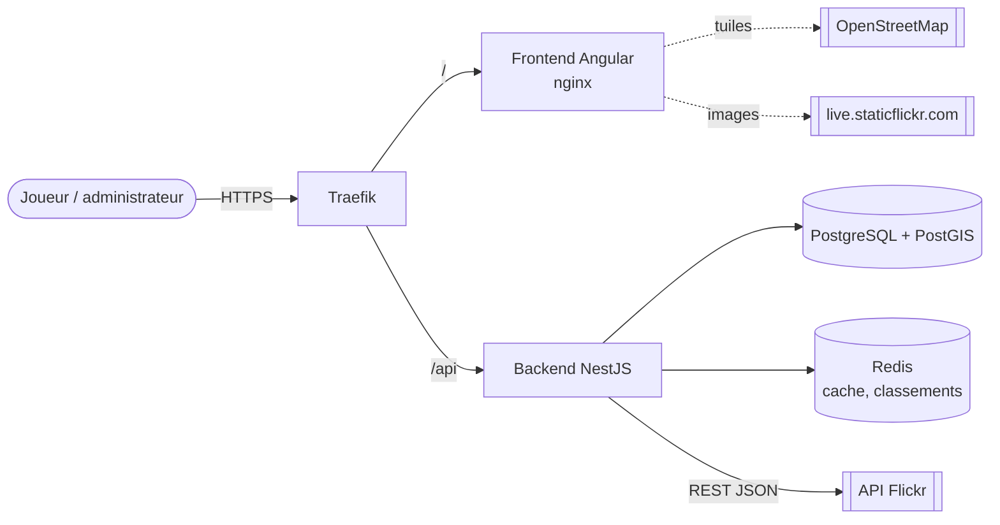
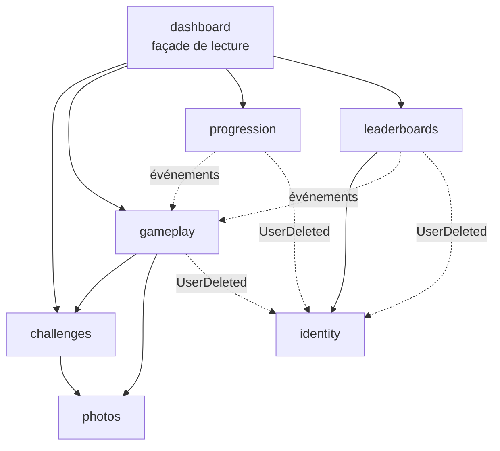
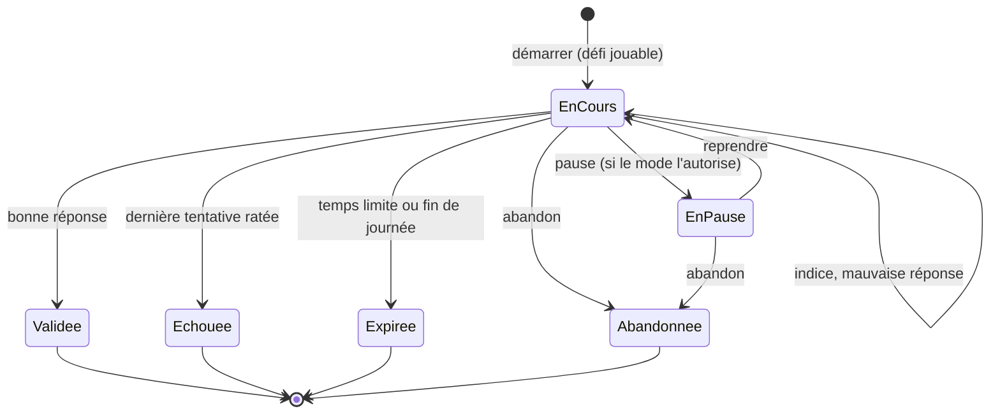
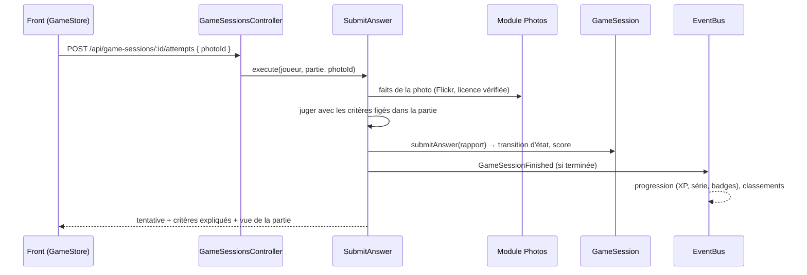
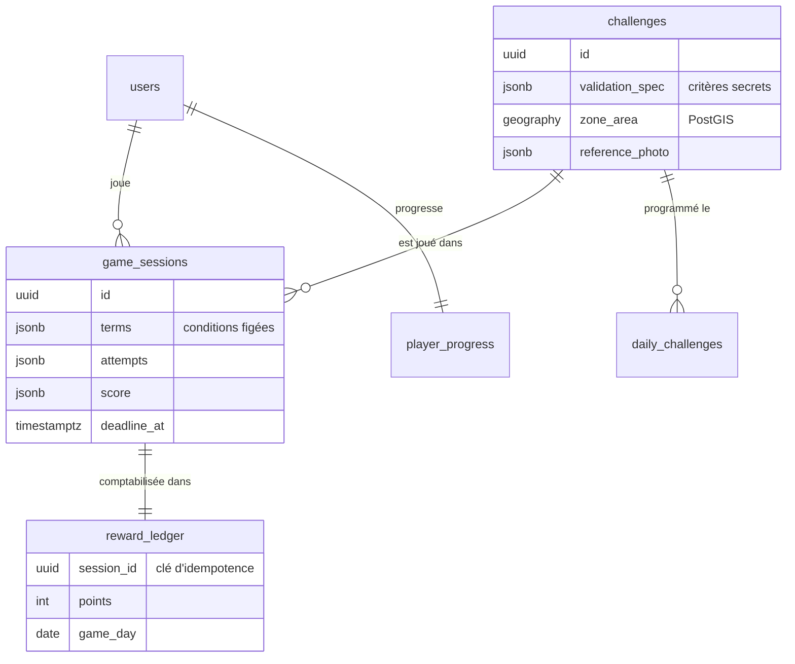

# Architecture

## Vue d'ensemble



Le backend est un **monolithe modulaire** : un seul déploiement, mais des modules métier étanches qui pourront devenir des services si la charge l'exige ([ADR 0001](adr/0001-monolithe-modulaire-hexagonal.md)).

## Modules et dépendances



- Flèches pleines : appels via le `public-api.ts` du module cible (façades et ports publiés).
- Flèches pointillées : réactions à des **événements de domaine** ; le module émetteur ignore ses abonnés
  ([ADR 0006](adr/0006-evenements-de-domaine.md)).
- Le câblage Nest importe aussi la classe `*.module.ts` et les jetons d'injection du module cible ; les
  contrôleurs utilisent les décorateurs d'authentification du module `identity`.

## Couches d'un module

```text
presentation   contrôleurs REST, DTO de validation d'entrée, gardes       ← dépend de application
application    cas d'usage, ports sortants, vues (modèles de lecture)     ← dépend de domain
domain         agrégats, objets-valeurs, règles, événements, ports        ← ne dépend de rien
infrastructure adaptateurs : PostgreSQL, mémoire, Redis, Flickr, JWT      → implémente les ports
```

Le domaine et les cas d'usage sont du TypeScript pur (aucun import de Nest, de `pg` ou de Flickr). Les cas d'usage sont instanciés par des fabriques dans chaque module Nest : c'est la racine de composition, seul endroit où les implémentations concrètes sont choisies (inversion de dépendances).
`src/testing/in-memory-app.ts` compose exactement les mêmes cas d'usage sans framework pour les tests.

## Cycle de vie d'une partie



Le chronomètre mesure le **temps actif** (la pause l'arrête). Les conditions de jeu (indices, barème, critères, temps limite) sont **figées dans la partie** au démarrage : modifier un défi publié ne change jamais les règles d'une partie en cours.

## Soumission d'une réponse



Les faits d'une photo (date, position, mots-clés) sont toujours relus côté serveur : un client ne peut pas falsifier une réponse. La photo de référence n'est révélée qu'une fois la partie terminée.

## Modèle de données



Les relations entre modules sont logiques (identifiants), sans clé étrangère inter-modules ([ADR 0005](adr/0005-persistance-sql-explicite.md)).
Index notables : partie active unique par joueur et défi, défi quotidien unique par joueur et jour (index uniques partiels), index GiST sur la zone des défis.

## Exigences non fonctionnelles (§8)

| Exigence | Réponse |
| --- | --- |
| Performance | Pagination partout ; 30 photos max par page ; chargement progressif ; cache Redis des recherches et fiches ; classements en ensembles triés Redis |
| Sécurité | JWT signé HS256 à durée courte ; gardes globales « sécurisé par défaut » ; rôles ; validation des entrées (DTO + domaine) ; limitation de débit (stricte sur l'authentification) ; scrypt N=2^17 ; helmet ; CSP côté nginx |
| Disponibilité | Disjoncteur + réessais exponentiels sur Flickr ; message 503 explicite ; le tableau de bord se dégrade sans bloquer |
| Scalabilité | Backend sans état (JWT, Redis) ; verrouillage optimiste ; migrations sous verrou consultatif ; tâches périodiques sans chevauchement |
| Accessibilité | Navigation clavier, focus visible, régions `aria-live`, libellés explicites, planche contact accessible en alternative à la carte, `prefers-reduced-motion` |
| Confidentialité | Aucune géolocalisation demandée dans le MVP ; suppression de compte propagée à tous les modules ; aucun corps de requête journalisé |
| Maintenabilité | Modules étanches, couches, tests du domaine et des cas d'usage, scénarios complets, documentation OpenAPI (/api/docs) |
| Observabilité | Journal JSON structuré, identifiant de corrélation `x-request-id`, durée et échec de chaque appel Flickr, sondes `/api/health` et `/api/health/ready` |
